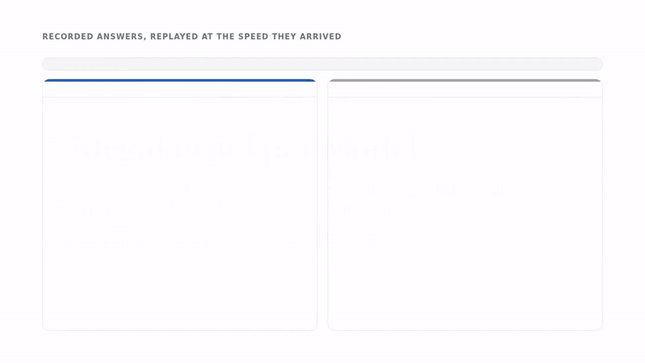
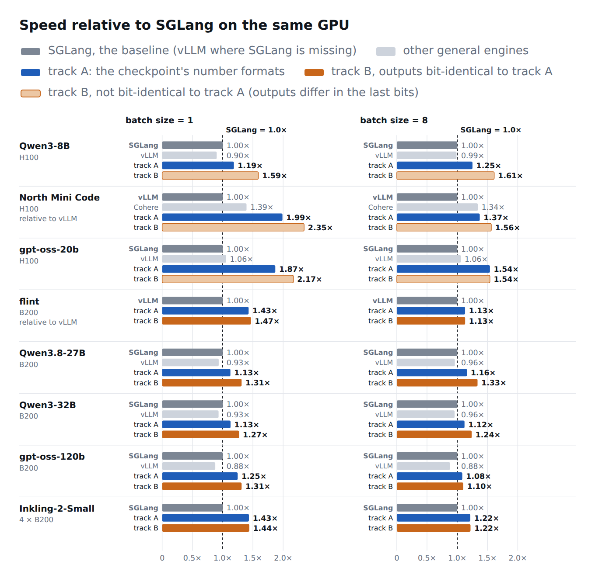
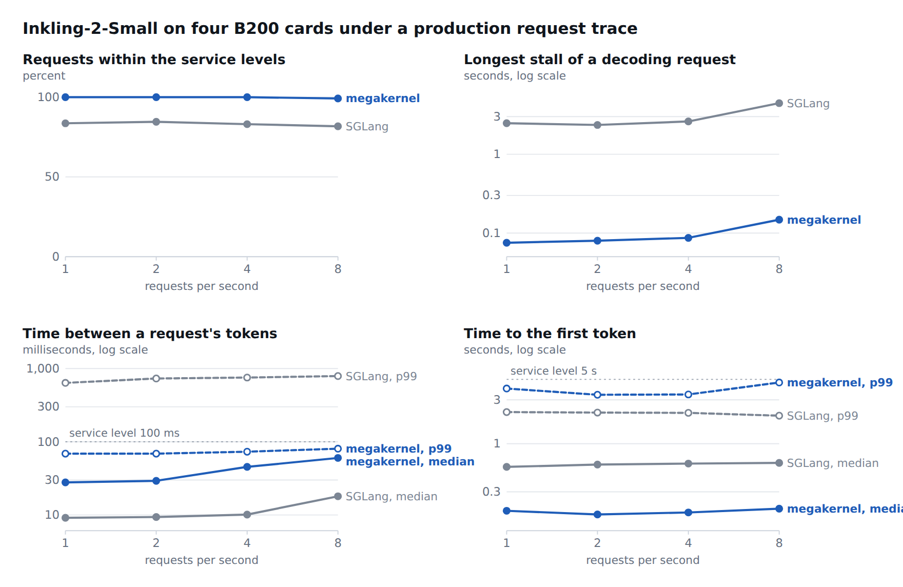

<div align="center">

# megakernel-zoo

**Model-specific megakernel inference engines for LLM decoding, written by coding agents**

[](LICENSE)
[](pyproject.toml)
[](#installation)
[](#supported-models)
[](https://dangxingyu.github.io/megakernel-dashboard/)

[Blog post](https://dangxingyu.github.io/megakernel-dashboard/) | [Benchmark data](https://dangxingyu.github.io/megakernel-dashboard/full.html) | [Quick start](#quick-start) | [Benchmarks](#benchmarks) | [Build your own engine](#build-your-own-engine) | [Contributing](CONTRIBUTING.md)

</div>

<p align="center"></p>

**megakernel-zoo** is a collection of LLM inference engines, each built for exactly one checkpoint on one GPU
architecture. A megakernel runs the whole decode step (every transformer layer, choosing the next token and feeding it back)
as one GPU program: one persistent CUDA kernel for the steady-decode engines, a
device-scheduled kernel loop for the serving engines. Between tokens there is no kernel launch per operator and no
synchronization with the host, and the work split, weight layout and memory traffic are fixed at compile time for the
checkpoint's shapes.

Every engine in this repository was written by a coding agent (Claude) in an autonomous optimization run against a fixed
evaluator, and audited afterwards. The repository contains the engines, an OpenAI-compatible server for them, the
evaluator and benchmark suite, and the tooling to run the same kind of optimization on another model or GPU.

- With the checkpoint's own number formats (track A), steady decoding is 1.13–1.43× as fast as the fastest general
  engine on the same card (vLLM, SGLang, or Cohere's megakernel for North Mini Code) with one sequence, on five models
  from 8 B to 594 B parameters. With lossless model-specific weight storage (track B) it reaches 1.68×.
- On a production request trace at 8 requests per second, the Inkling-2-Small serving engine keeps 99.2% of requests
  within the service levels (SGLang 81.7%). Its longest stall is 0.15 s (SGLang 4.4 s).
- `mkserve` serves any engine through the OpenAI completions and chat-completions API, with streaming and sampling.
- An engine is timed only after its logits match a float64 reference of the model at every position. The evaluator
  and the reference builder are in the repository.
- [`runs/`](runs) has the source, the hypothesis and the score of every submission of the agent runs.

## News

- **2026-11-17** New `mkserve` commands `doctor`, `pull`, `chat` and `bench`; options `--api-key` and `--served-model-name`; a
  `/metrics` endpoint. The autoresearch kit adds a phase profiler for persistent kernels, a bit-identity check between two
  builds, and a playbook of what the earlier runs measured.
- **2026-11-16** Initial release: 13 engines for 5 models on H100 and B200, `mkserve`, the evaluation suite and the
  autoresearch kit. Write-up: [A Megakernel per Model](https://dangxingyu.github.io/megakernel-dashboard/).

## Contents

- [Supported models](#supported-models)
- [Installation](#installation)
- [Quick start](#quick-start)
- [Benchmarks](#benchmarks)
- [Evaluation suite](#evaluation-suite)
- [Build your own engine](#build-your-own-engine)
- [Repository layout](#repository-layout)
- [Limitations](#limitations)
- [Citation](#citation)

## Supported models

| Model | Parameters | GPU | Steady-decode engines | Serving engines |
|---|---|---|---|---|
| [Qwen/Qwen3-8B](https://huggingface.co/Qwen/Qwen3-8B) | 8.2 B, dense | 1 × H100 | track A, track B | track A, track B |
| [CohereLabs/North-Mini-Code-1.0](https://huggingface.co/CohereLabs/North-Mini-Code-1.0) | 30.5 B, MoE (128 experts per layer) | 1 × H100 | track A, track B | – |
| [RecursiveSI/flint](https://huggingface.co/RecursiveSI/flint) | 39.8 B, MoE (256 experts per layer) | 1 × B200 | track A, track B | – |
| [Qwen/Qwen3.8-27B](https://huggingface.co/Qwen/Qwen3.8-27B) | 27.8 B, dense | 1 × B200 | track A, track B | – |
| [thinkingmachines/Inkling-2-Small](https://huggingface.co/thinkingmachines/Inkling-2-Small) | 594 B, MoE (384 experts per layer, 4-bit experts) | 4 × B200 | track A, track B | track A |

**Track A** keeps the checkpoint's weights, number formats and data flow, and changes only how the computation is
organized on the card. **Track B** may additionally change how the model is stored and what is precomputed at load time,
as long as the function is unchanged in exact arithmetic (no quantization, pruning or approximation). The track-B engines
of Qwen3.8-27B and Inkling-2-Small are bit-identical to track A; the other three keep intermediates in float32 where the
reference implementation rounds to BF16, so they are at least as accurate but not bit-identical.

A **steady-decode** engine holds up to 8 sequences and a 2,048-token context and is the fastest at decoding. A **serving**
engine admits requests while others decode, processes prompts in chunks inside the kernel, pages K/V memory and reuses
shared prompt prefixes (64 sequences, 34,816-token context).

## Installation

**Prerequisites**

- The GPU an engine was built for: NVIDIA H100 (sm_90a) or B200 (sm_100a); Inkling-2-Small needs a node with four B200.
- CUDA toolkit 13.x with `nvcc` on `PATH` (engines are compiled from source on first use). Tested with CUDA 13.2.
- Python 3.10 or newer and PyTorch with CUDA support. Tested with Python 3.12 and PyTorch 2.15.

**Install from source**

```bash
git clone https://github.com/dangxingyu/megakernel-zoo.git
cd megakernel-zoo
pip install -e .            # installs the `mkserve` command
```

The evaluation scripts create their own environments with [`uv`](https://docs.astral.sh/uv/).

## Quick start

Check the machine, list the engines and serve one (the weights are downloaded from Hugging Face; `--model-dir` uses a
local snapshot):

```bash
mkserve doctor Qwen/Qwen3-8B                         # card, CUDA toolkit, Python packages, engines for this card
mkserve list
mkserve serve Qwen/Qwen3-8B --port 8000              # the default engine of this model on this card
mkserve serve Qwen/Qwen3-8B --engine offline-b       # a specific engine
```

Then talk to it, or time it on the benchmark workload (the same command times vLLM or SGLang with `--url`):

```bash
mkserve chat
mkserve bench --batch 1 8
```

Query it with any OpenAI-compatible client:

```python
from openai import OpenAI

client = OpenAI(base_url="http://127.0.0.1:8000/v1", api_key="none")
stream = client.chat.completions.create(
    model="Qwen/Qwen3-8B",
    messages=[{"role": "user", "content": "Explain how a hash table works."}],
    max_tokens=512,
    stream=True,
)
for chunk in stream:
    print(chunk.choices[0].delta.content or "", end="", flush=True)
```

`mkserve` validates every request before the engine sees it (context length, token ids, `max_tokens`) and implements
sampling (`temperature`, `top_p`, `top_k`, `seed`) on the engine's logits. An engine is tied to one model and one GPU
type; any other pair is refused. See [`mkserve/README.md`](mkserve/README.md) for endpoints and options.

<details>
<summary><b>All registered engines</b></summary>

| Model | Card | Engine | Track | Kind | Sequences | Context | From |
|---|---|---|---|---|---|---|---|
| Qwen/Qwen3-8B | h100 | `online-b` (default) | B | online | 64 | 34,816 | run s3-q8b-online-a1, submission s0039 |
| Qwen/Qwen3-8B | h100 | `online-a` | A | online | 64 | 34,816 | run s3-q8b-online-a1, submission s0038 |
| Qwen/Qwen3-8B | h100 | `offline-b` | B | offline | 8 | 2,048 | run s10-q8b-h100-f1, submission s0002 |
| Qwen/Qwen3-8B | h100 | `offline-a` | A | offline | 8 | 2,048 | run s10-q8b-h100-f1, submission s0003 |
| RecursiveSI/flint | b200 | `offline-a` (default) | A | offline | 8 | 2,048 | run s11-flint-b200-b1, submission s0026 |
| RecursiveSI/flint | b200 | `offline-b` | B | offline | 8 | 2,048 | run s11-flint-b200-b1, submission s0027 |
| Qwen/Qwen3.8-27B | b200 | `offline-a` (default) | A | offline | 8 | 2,048 | run s9-qwen38-27b-b200-f1, submission s0022 |
| Qwen/Qwen3.8-27B | b200 | `offline-b` | B | offline | 8 | 2,048 | run s11-q27-b200-b1, submission s0020 |
| CohereLabs/North-Mini-Code-1.0 | h100 | `offline-a` (default) | A | offline | 8 | 2,048 | run s4-north-h100-a1, submission s0022 |
| CohereLabs/North-Mini-Code-1.0 | h100 | `offline-b` | B | offline | 8 | 2,048 | run s4-north-h100-a1, submission s0021 |
| thinkingmachines/Inkling-2-Small | b200x4 | `offline-a` (default) | A | offline | 8 | 2,048 | run s7-inkling2s-b200x4-fb1, submission s0034 |
| thinkingmachines/Inkling-2-Small | b200x4 | `offline-b` | B | offline | 8 | 2,048 | run s7-inkling2s-b200x4-fb1, submission s0036 |
| thinkingmachines/Inkling-2-Small | b200x4 | `online-a` | A | online | 64 | 34,816 | run s8-inkling2s-b200x4-on1, submission s0043 |

</details>

## Benchmarks

<p align="center"></p>

Time per token over HTTP with a 64-token prompt and 1,024 greedy tokens. The factor is the fastest general engine's time
divided by ours, with one sequence and with eight.

| Model | Card | Fastest general engine, ms | Track A, ms | Track A | Track B, ms | Track B |
|---|---|---|---|---|---|---|
| Qwen3-8B | H100 | SGLang 6.13 / 6.84 | 5.38 / 5.64 | **1.14×** / **1.21×** | 4.16 / 4.47 | **1.47×** / **1.53×** |
| North Mini Code | H100 | Cohere's own megakernel 3.62 / 7.07 | 2.54 / 6.90 | **1.43×** / 1.02× | 2.15 / 6.05 | **1.68×** / **1.17×** |
| flint | B200 | vLLM 1.99 / 3.79 | 1.39 / 3.35 | **1.43×** / **1.13×** | 1.36 / 3.35 | **1.47×** / **1.13×** |
| Qwen3.8-27B | B200 | SGLang 9.53 / 10.30 | 8.45 / 8.89 | **1.13×** / **1.16×** | 7.26 / 7.72 | **1.31×** / **1.33×** |
| Inkling-2-Small | 4 × B200 | SGLang 4.74 / 6.55 | 3.30 / 5.39 | **1.43×** / **1.22×** | 3.29 / 5.38 | **1.44×** / **1.22×** |

How the comparison is made:

- **Same card, same job.** All systems of a row run on the same card in the same job, one after another, for three
  rounds; each round restarts every server.
- **Same interface and client.** Every system is behind an OpenAI-compatible streaming endpoint and timed by one client
  ([`eval/client.py`](eval/client.py)) that records the arrival of each token.
- **Same work.** Prompts are sent as token ids, every request generates exactly 1,024 tokens, and time per token is taken
  over the window in which all sequences decode.
- **Released baselines.** vLLM and SGLang are installed from their releases and run with their recommended flags, or a
  faster setting where we found one. For North Mini Code the reference is the vendor's own hand-written megakernel.

**Serving a production request trace** (300-second replay of the
[Mooncake tool-and-agent trace](https://github.com/kvcache-ai/Mooncake/tree/main/FAST25-release/traces), all systems over HTTP on
the same hardware; a request is within the service levels when its first token arrives within 5 s and its tokens are on
average at most 0.1 s apart):

| Model, GPU | Rate | Within service levels | Longest stall |
|---|---|---|---|
| Inkling-2-Small, 4 × B200 | 1–4 req/s | **100%** vs 83–85% (SGLang) | 0.08–0.09 s vs 2.4–2.6 s |
| Inkling-2-Small, 4 × B200 | 8 req/s | **99.2%** vs 81.7% (SGLang) | 0.15 s vs 4.4 s |
| Qwen3-8B, 1 × H100 | 1–2 req/s | **95–97%** vs 68–75% (SGLang, vLLM) | 0.09–0.11 s vs 0.5–6.9 s |
| Qwen3-8B, 1 × H100 | 3 req/s | **90–93%** vs 59–68% (SGLang, vLLM) | 0.09 s vs 0.6–7.3 s |

<p align="center"></p>

The serving engines have a slower 99th-percentile first token and, on Inkling-2-Small, a slower median time
between tokens. Every measurement, including batch sizes from 1 to 64, long generations, long prompts, natural-text
prompts and sampling, is in the [benchmark data tables](https://dangxingyu.github.io/megakernel-dashboard/full.html); the write-up discusses the limits.

To reproduce a comparison on your own card:

```bash
# serves each system in turn on this card and times it with one client
MK_MODEL=Qwen/Qwen3-8B COMPARE_SYSTEMS="mkserve:offline-a mkserve:offline-b sglang vllm" bash scripts/compare.sh
```

## Evaluation suite

```bash
bash scripts/eval_selftest.sh Qwen/Qwen3-8B      # once per model: weights, a float64 reference on this card, the evaluator on the starter
MK_MODEL=Qwen/Qwen3-8B bash scripts/eval_setup.sh
python eval/kernel_eval.py --workspace engines/qwen3-8b_h100/offline-a --out result.json
```

[`eval/kernel_eval.py`](eval/kernel_eval.py) builds an engine and reports a time only if it is correct:

| Gate | What is checked |
|---|---|
| `numeric`, `numeric_long` | logits against a float64 run of the reference model at every position to 128 and at every 8th position to 1,152, alone and in a batch of 8; relative error within 2× that of the Hugging Face BF16 implementation |
| `tokens` | top-1 agreement with float64 within one point of the BF16 implementation's |
| `batch` | a sequence alone and inside a batch give the same logits |
| `generate`, `http_tokens` | the engine's own decode loop and its HTTP path reproduce its step-by-step greedy tokens |
| `timed_steps` | the steps that were timed are checked against the reference afterwards |

The reference is computed on your card for the token sequences in [`eval/refs/`](eval/refs) (the ones our runs were
scored on), so results are comparable with ours. [`eval/release_check.py`](eval/release_check.py) adds every batch size
from 1 to 8, slot permutation, neighbour independence, repetition, state after a full context, and a process restart;
[`scripts/mkserve_check.py`](scripts/mkserve_check.py) tests a served engine through the API.

## Build your own engine

The engines were produced by an agent that edits one engine directory, measures on the GPU, and submits to the evaluator
above. The same loop runs on a single machine:

```bash
bash scripts/eval_selftest.sh Qwen/Qwen3-8B
python autoresearch/start.py my-run --model Qwen/Qwen3-8B --card h100 --hours 12
cd my-run/workspace && claude -p "$(cat ../PROMPT.md)" --dangerously-skip-permissions
```

`start.py` creates a workspace with a starting engine (the Hugging Face model behind the engine contract, or any engine
of this repository with `--engine`), installs the skill, writes the prompt, and gives the agent one tool: `mk submit`
evaluates the engine and records the result, `mk board` shows every submission and the time left. Any coding agent with
a shell can drive it. The prompts state the goal, the rules and the two tracks; they name no optimization technique.

- [`autoresearch/skills/megakernel`](autoresearch/skills/megakernel): the skill every run starts from (the engine
  contract, how the evaluator scores, how to log).
- [`autoresearch/skills_by_model`](autoresearch/skills_by_model): the skills of our runs, with the facts of each model
  and card.
- [`autoresearch/skills/megakernel/playbook.md`](autoresearch/skills/megakernel/playbook.md): what the 12 runs measured:
  where each engine's time went, which changes paid and by how much, track-B formats, dead ends, correctness traps.
- [`autoresearch/tools`](autoresearch/tools): `mkprof` (phase timings inside a persistent kernel, which a profiler sees
  as one kernel), `bitcheck.py` (are two builds the same function, bit for bit?) and `weights_census.py` (exact
  statistics of a checkpoint's weights).
- [`runs/`](runs): every submission of our 12 runs (source, hypothesis, score) and the agents' notes, as worked examples.

For a model that is not in Hugging Face `transformers`, a reference implementation has to be written first;
[`eval/inkling2_ref.py`](eval/inkling2_ref.py) is the one for Inkling-2-Small. To add an engine to this repository, see
[CONTRIBUTING.md](CONTRIBUTING.md).

## Repository layout

```
engines/        one directory per engine: CUDA source, build script, Python binding (engine/api.py)
mkserve/        OpenAI-compatible server and the engine registry
eval/           evaluator, reference builder, benchmark client, extended checks
scripts/        environment setup, same-card comparison, server tests
baselines/      how the general engines were installed and launched
autoresearch/   the local optimization loop: tools, skills, prompts
starter/        the reference model behind the engine contract (where a run starts)
runs/           the record of every agent run
```

## Limitations

- An engine is specific to one checkpoint and one GPU type, and is compiled on the machine that serves it.
- Steady-decode engines hold 8 sequences and a 2,048-token context and read the prompt one token per pass.
- Decoding inside the kernel is greedy; sampling runs in `mkserve` and costs 1 to 11%.
- Use the engines through `mkserve`: called directly, most of them do not validate requests. The serving engines for
  Qwen3-8B match shared prompt prefixes by a 64-bit hash without comparing tokens.
- Benchmark numbers are from single nodes and two to three rounds.

The findings of the independent audit of every engine are summarized in the [write-up](https://dangxingyu.github.io/megakernel-dashboard/#limits).

## Citation

```bibtex
@misc{dang2026megakernel,
  title        = {A Megakernel per Model},
  author       = {Dang, Xingyu},
  year         = {2026},
  howpublished = {\url{https://dangxingyu.github.io/megakernel-dashboard/}},
  note         = {Code: \url{https://github.com/dangxingyu/megakernel-zoo}}
}
```

## License and acknowledgements

Apache-2.0. `eval/inkling2_ref.py` began as a transcription of model code from NovaSky-AI/SkyRL (Apache-2.0), as noted in
the file. The baselines are [vLLM](https://github.com/vllm-project/vllm), [SGLang](https://github.com/sgl-project/sglang)
and Cohere's megakernel for North Mini Code; the request trace is the tool-and-agent trace released with
[Mooncake](https://github.com/kvcache-ai/Mooncake) ([FAST '25](https://www.usenix.org/conference/fast25/presentation/qin)).
